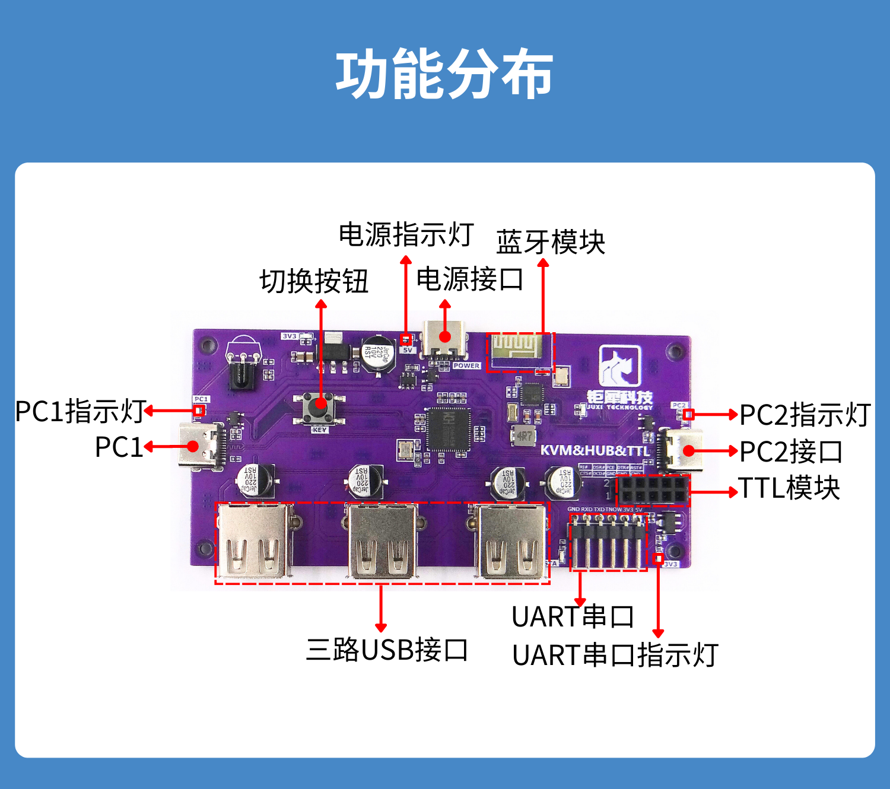
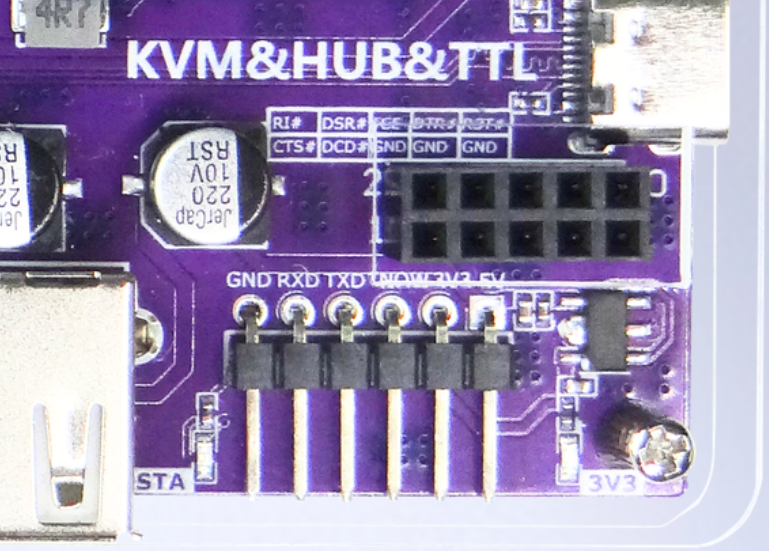
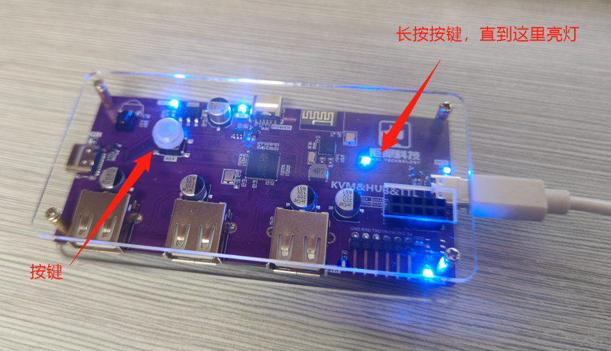
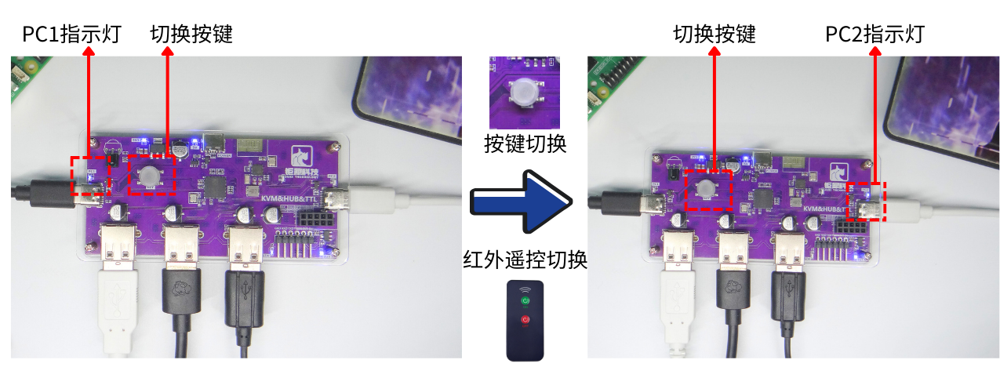
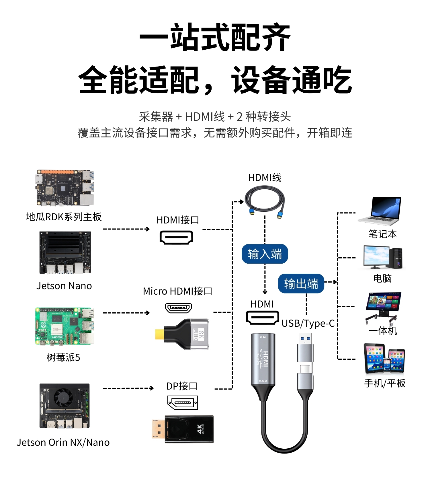
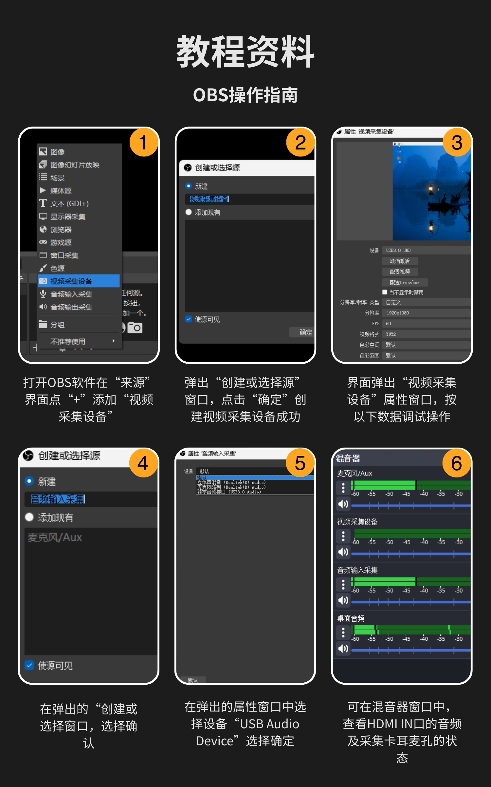
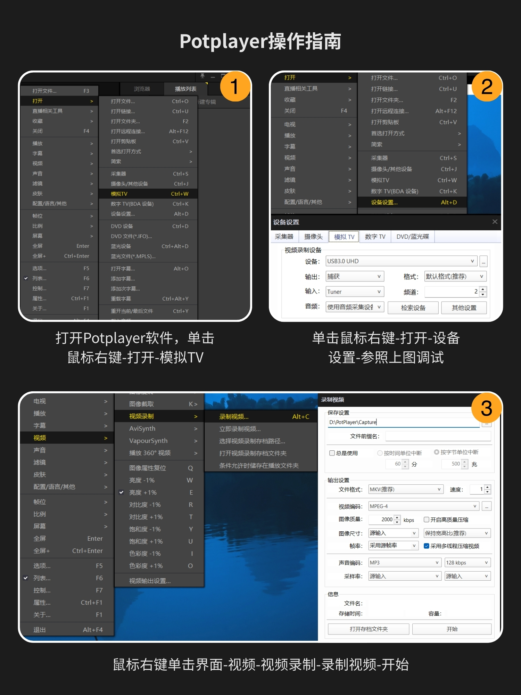
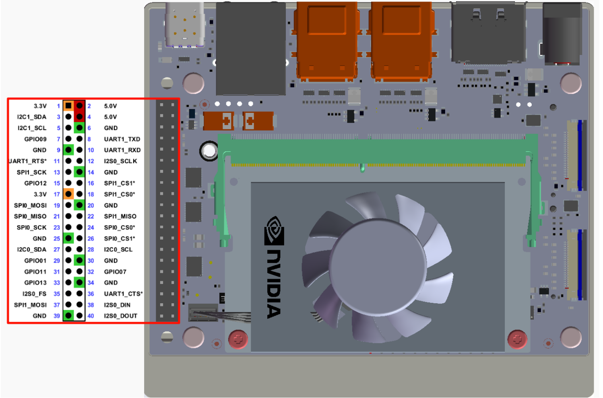
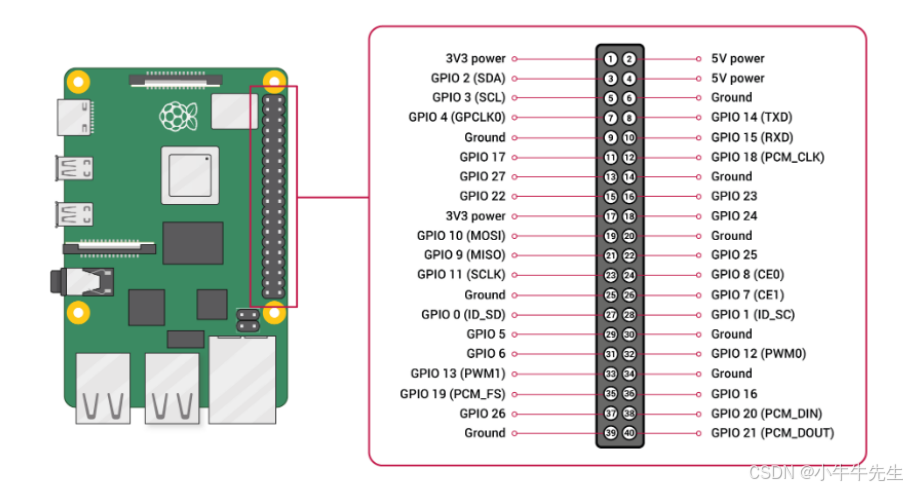
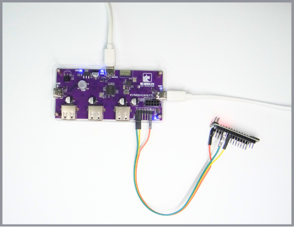

[English](../en/kvm-switch-tutorial.md) | [Deutsch](../de/kvm-switch-tutorial.md) | [Español](../es/kvm-switch-tutorial.md) | [Français](../fr/kvm-switch-tutorial.md) | [Italiano](../it/kvm-switch-tutorial.md) | [日本語](../ja/kvm-switch-tutorial.md) | 한국어 | [Português (BR)](../pt-br/kvm-switch-tutorial.md) | [Português (PT)](../pt-pt/kvm-switch-tutorial.md) | [简体中文](../zh-hans/kvm-switch-tutorial.md) | [繁體中文](../zh-hant/kvm-switch-tutorial.md)

# KVM 스위치 사용 튜토리얼

KVM 스위치에는 HUB 기능, TTL 시리얼 포트, Bluetooth 모듈이 포함되어 있습니다

## 개별 모듈 기능

### 1、HUB 기능

USB\-TypeC 케이블 한 개만으로 하나의 USB 인터페이스를 세 개의 USB 인터페이스로 확장할 수 있습니다

### 2、TTL 시리얼 포트

핀은 왼쪽에서 오른쪽으로 각각 GND RXD TXD TNOW 3V3 5V 입니다

### 3、Bluetooth 모듈

AT 명령으로 연결하거나 슬레이브 모드로 변경합니다. 스마트폰은 4\.2 프로토콜로 연결해야 합니다

## 양단 전환

### 1、장치 A\+장치 B（양쪽 모두 디스플레이 있음）

버튼 전환\&적외선 리모컨 전환

### 2、메인보드（디스플레이 없음）\+호스트（디스플레이 있음）

추가로 4K HD HDMI 캡처보드 하나를 호스트 측에 연결하기만 하면, **호스트 측**에서 OBS, PotPlayer 등의 소프트웨어를 사용하여 **메인보드（디스플레이 없음）** 화면을 캡처할 수 있습니다

**4K HD HDMI 캡처보드 배선 작업**

메인보드의 인터페이스에 따라 아래 세 가지 배선 작업으로 나뉩니다

**HDMI 인터페이스**——\>HDMI 케이블——\>캡처보드의 HDMI 인터페이스——\> USB/Type\-C ——\>노트북, 컴퓨터, 일체형 컴퓨터, 스마트폰/태블릿 등의 디스플레이

**Micro HDMI 인터페이스**——\>Micro-HDMI 변환 어댑터——\>HDMI 케이블——\>캡처보드의 HDMI 인터페이스——\> USB/Type\-C ——\>노트북, 컴퓨터, 일체형 컴퓨터, 스마트폰/태블릿 등의 디스플레이

**DP 인터페이스**——\>DP-HDMI 변환 어댑터——\>HDMI 케이블——\>캡처보드의 HDMI 인터페이스——\> USB/Type\-C ——\>노트북, 컴퓨터, 일체형 컴퓨터, 스마트폰/태블릿 등의 디스플레이

**OBS 조작 가이드**

**PotPlayer 조작 가이드**

핀 배치도 예시

